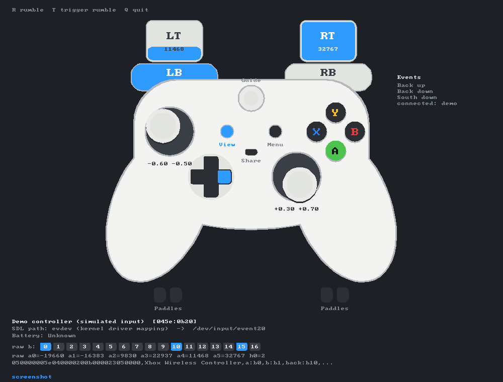

# pad-viewer

A small Rust + SDL3 app that draws a white gamepad and lights up each
control live: face buttons, bumpers, triggers (filled by how far they're
pulled), sticks (caps move, clicks light), D-pad, View, Menu, Guide, Share
and Elite paddles. Below the drawing it shows the device name, VID:PID,
whether SDL went through evdev or HIDAPI, the battery, SDL's raw joystick
buttons and axes (the `b<N>`/`a<N>` numbers a mapping string uses), and the
mapping string itself. Recent button events are listed on the right.



## Build and run

```sh
sudo apt install cargo libsdl3-dev pkg-config
cd tools/pad-viewer
cargo run --release
```

Or without libsdl3-dev, building SDL3 from source and linking it in
(needs cmake and the usual X11/Wayland/ALSA dev packages):
`cargo run --release --features vendored`.

Keys: `R` rumble, `T` trigger rumble (reports if the device has none),
`Q`/`Esc` quit.

Options:

- `--no-hidapi`: make SDL use the kernel's evdev device even when it could
  open the controller's hidraw node. Use it to see exactly what the kernel
  driver gives games. Without read access to `/dev/hidraw*` (the default for
  Xbox controllers on Ubuntu) SDL uses evdev anyway.
- `--screenshot FILE.bmp`: render one frame with simulated input and exit.
  Works headless with `SDL_VIDEO_DRIVER=offscreen`.

The controller is drawn from simple shapes; it is not Microsoft artwork.
